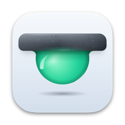
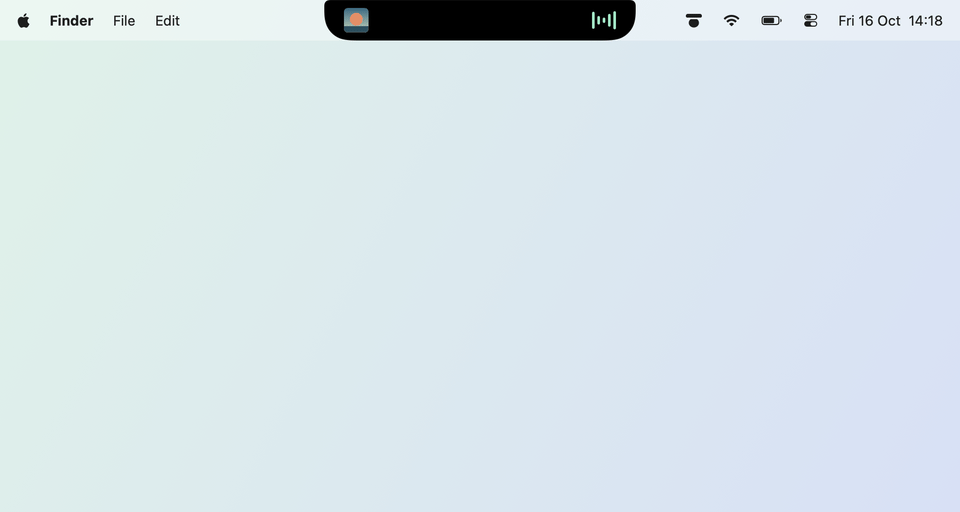

# Brimlet

**Music, a timer and your next meeting, right in your MacBook’s notch.**

[Website](https://hamzabasaran.com/brimlet) · [Download Brimlet.dmg](https://github.com/mehambas/brimlet/releases/latest/download/Brimlet.dmg) · [Changelog](CHANGELOG.md)

Brimlet turns the black strip around your MacBook’s notch into a small, quiet panel. It shows the track playing in Spotify, a timer, your next meeting and your tasks, and opens when you point at it. On displays without a notch it sits at the top of the screen as a small capsule. No account, no analytics.

<picture>
  <source media="(prefers-color-scheme: dark)" srcset="docs/images/demo-dark.gif">
  
</picture>

## Features

- **Music.** The track, artist and album art from the Spotify app, a seek bar, play/pause, previous and next. When the track changes, Brimlet peeks out with the controls. Lyrics, synced line by line where available.
- **Timer.** 5, 15, 25 or 45 minutes, with pause and a sound when time is up. It stays right through sleep.
- **Calendar.** Today, tomorrow or the next seven days from the calendars on your Mac, with a **Join** button for Google Meet, Zoom, Teams and Webex links and a reminder 5 or 10 minutes before. Read only, and off until you turn it on.
- **Tasks.** A short list for home, personal and work, with due dates and a reminder at 9:00 on the day.
- **Quotes.** Select text in most apps, choose **Services › Add to Brimlet as Quote**, and Brimlet shows one of your quotes now and then.
- **Notifications from other apps** you allow, through a small local [interface for developers](docs/external-notifications.md).
- Expands on hover or click, follows Reduce Motion, hides when an app fills the screen, and can live on any display.
- Native SwiftUI and AppKit, in English and Turkish. Apple silicon and Intel, macOS 14 or later.

## Install

1. Download [Brimlet.dmg](https://github.com/mehambas/brimlet/releases/latest/download/Brimlet.dmg) from the [latest release](https://github.com/mehambas/brimlet/releases/latest).
2. Open it and drag **Brimlet** to **Applications**.
3. Eject the disk image and open Brimlet from **Applications**, not from the disk image. Brimlet is not notarized by Apple (that needs a paid developer account), so macOS blocks the first launch:
   - macOS says it could not verify Brimlet. Click **Done**.
   - Open **System Settings › Privacy & Security**, scroll down to *“Brimlet” was blocked*, click **Open Anyway** and confirm.

   On macOS 14 you can instead Control-click Brimlet in Applications and choose **Open**. This is needed once per download.
4. Brimlet opens at the notch and puts its icon in the menu bar.

For music, install the [Spotify app for Mac](https://www.spotify.com/download/mac/) and click **Connect to Spotify**. macOS asks whether Brimlet may control Spotify; allow it. Brimlet talks to the Spotify app on your Mac, not to your Spotify account, so the web player does not work with it.

To start Brimlet when you log in, turn on **Settings › General › Open at Login**.

### Updates

Brimlet checks for a new version once a day. When one is out, its menu bar menu starts with **Update to** and the version number, and **Settings › General** shows the release notes and **Download and Install**. That downloads the new disk image, verifies it and opens it, then Brimlet quits: drag **Brimlet** to **Applications** and replace the old version. **Check for Updates…** in the menu bar menu checks right away.

## Usage

Point at the notch, or click it, to open Brimlet; move away, click elsewhere or press **Escape** to close it. The tabs at the top switch between the modules. While something is going on, such as a playing track, a running timer or a meeting about to start, the small view shows it.

The menu bar icon opens Brimlet, hides or shows it, and opens **Settings**, which has five tabs:

- **General**: open at login, updates, display selection, expand on hover, hide in full screen and privacy.
- **Modules**: turn music, timer, calendar and tasks on or off, reorder them by dragging or using the arrows, connect Spotify, and set track change peeks and the timer sound.
- **Calendar**: access, calendars to show and event reminders.
- **Notifications**: apps allowed to show notifications and, when installed, cmux sessions.
- **Quotes**: how often a quote appears, how long it stays, and your saved quotes.

Settings, task entry and quote cards follow the Mac’s light or dark appearance. The notch panel stays black, with graphite surfaces and mint controls.

macOS asks for permission only when a feature needs it:

| Permission | When |
| --- | --- |
| Automation › Spotify | You click **Connect to Spotify** |
| Calendars (full access) | You turn on the calendar module |
| Notifications | You set a reminder on a task |

## Privacy

- Brimlet has no account and no telemetry, and nothing goes to a server of ours. It makes three kinds of requests:
  - the album art of the current track, from the address Spotify gives for it;
  - the lyrics of the current track from [LRCLIB](https://lrclib.net), only while lyrics are open: it sends the title, artist and length of the track;
  - the latest version number from GitHub, once a day. Turn it off with **Settings › General › Check for updates automatically**. An update is downloaded only when you click **Download and Install**.
- Calendar events are read when shown and never stored or changed.
- Settings, tasks and quotes are in `~/Library/Preferences/com.hamzabasaran.brimlet.plist`. `~/Library/Application Support/Brimlet` holds only the local connection for notifications from other apps.

## Uninstall

1. If **Open at Login** is on, turn it off in **Settings › General**.
2. Quit Brimlet from its menu bar icon and move `/Applications/Brimlet.app` to the Trash.
3. Remove its settings and permissions:

   ```sh
   rm -rf ~/Library/Application\ Support/Brimlet
   defaults delete com.hamzabasaran.brimlet
   tccutil reset All com.hamzabasaran.brimlet
   ```

## Build from source

You need macOS 14 or later and Xcode 16 or the Swift 6 command line tools. There are no other dependencies.

```sh
git clone https://github.com/mehambas/brimlet.git
cd brimlet
swift test --disable-sandbox
bash scripts/build.sh
open dist/Brimlet.app
```

`scripts/build.sh` builds a universal app. Without the release certificate it is signed ad hoc, so macOS asks for Spotify and calendar access again after each rebuild; see [How Brimlet works](docs/how-it-works.md#development) for a stable signature, the previews, the translations check and the release script.

## Support

Brimlet is free and open source. If it makes your day a little nicer, you can [buy me a coffee on Ko-fi](https://ko-fi.com/mehambas91) ☕

Found a bug or have an idea? [Open an issue](https://github.com/mehambas/brimlet/issues).

## License

[MIT](LICENSE)
